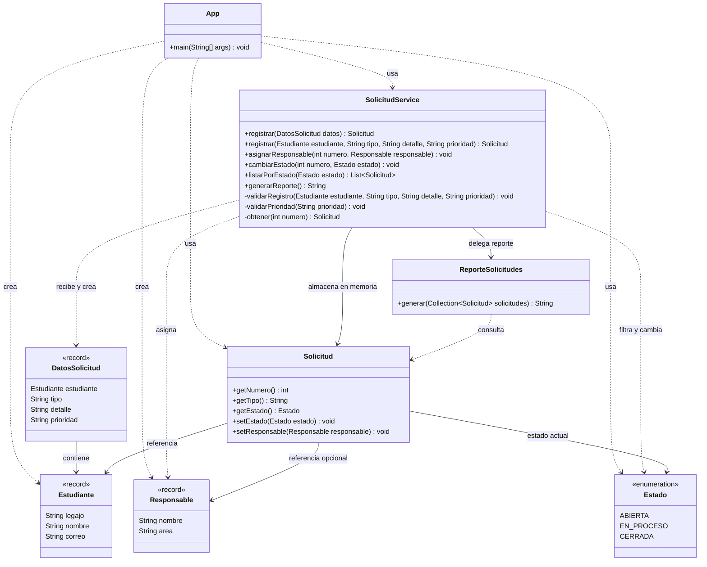

# Arquitectura del sistema

Describe el código de `integracion` revisado en `76c0ece`, posterior a R-01–R-04.

## Diagrama de clases simplificado

Representa únicamente los ocho tipos de producción existentes. Omite constructores, accesores y algunos miembros para facilitar la lectura.
Las flechas discontinuas indican uso; las continuas, referencias almacenadas. No expresan reglas de negocio adicionales.

## Alcance y límites

`SolicitudService` conserva las solicitudes en memoria y delega el formato del reporte en `ReporteSolicitudes`.
`DatosSolicitud`, `Estudiante` y `Responsable` son records; `Estado` es una enumeración.

El diagrama representa la implementación existente. `SolicitudRepository`, un `enum Prioridad`,
la inyección del reporte por constructor y las reglas de transición de estados siguen como propuestas
no implementadas.